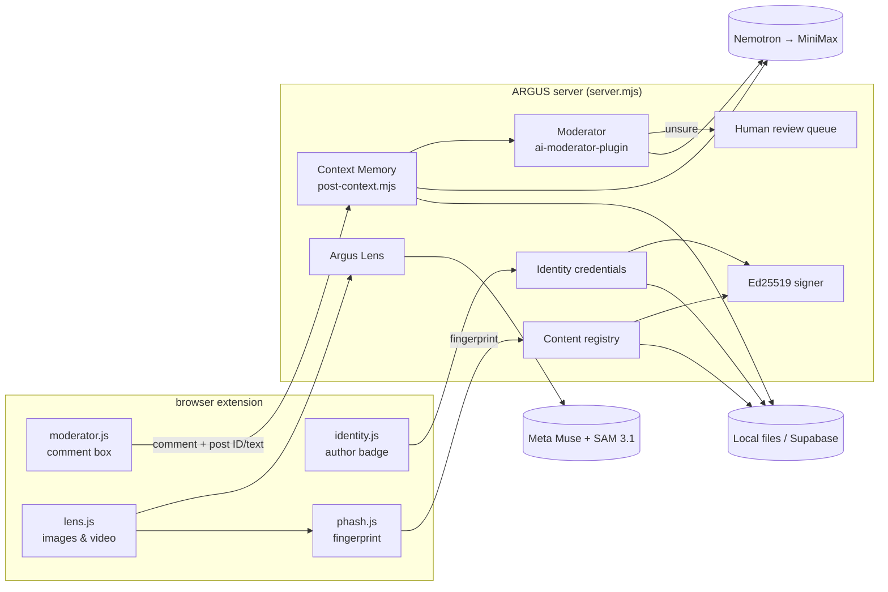

# ARGUS: Cross-Platform Digital Trust & Responsible AI Plugin

> **Vision: Verify who creates. Moderate what is shared. Protect what is owned. Trace how it circulates.**
>
> Team ARGUS · PSG College of Technology COMPUTE50 Golden Jubilee National Level Hackathon · Domain #10: Responsible AI and Resource Optimization

| | |
|---|---|
| **Demo video** (2:43) | [demo/ARGUS-demo.mp4](demo/ARGUS-demo.mp4) |
| **Presentation** | [ARGUS_COMPUTE50.pptx](ARGUS_COMPUTE50.pptx) · [PDF](ARGUS_COMPUTE50.pdf) |
| **Try it without real accounts** | run the server, then open http://localhost:8787/demo (WhatsApp-, YouTube-, Instagram- and X-style pages) |

ARGUS is a browser extension and a small server. It has three components, as in the presentation:

- **SafeSend** (AI-powered content moderator): checks text, images and video before they are shared, in the context of the post, and suggests a gentler way to say it. *Engines 01 Content Safety and 03 Authenticity below.*
- **ContentTrace** (ownership and traceability): gives creators a Content ID and a signed record, and recognises copies, crops and flips of their work. *Engine 02 Provenance.*
- **ARGUS ID** (unified digital identity): verifiable credentials for people, organisations and AI agents, with warnings on look-alikes. *Engine 04 Identity.*

It helps people answer five questions while they browse:

1. Is this content potentially harmful?
2. Is it original, authentic or modified?
3. Who created it, and has it been properly attributed?
4. Is this account or AI agent authorised to represent who it claims to?
5. Can we understand and trust the AI's decision?

It doesn't replace each platform's own tools. It connects safety, provenance, authenticity and identity checks in one place, and shows evidence and confidence rather than accusations.

## One extension for all of it

**ARGUS works in any text box on any site, like a spell-checker for harm**: WhatsApp Web, Gmail, X, Facebook, Messenger, LinkedIn, Discord, Telegram, YouTube, Reddit, Instagram, blogs and forums. A badge in the box shows how your text reads as you type; click it for the reason and a better way to say it. When you press Send, Post, Reply or Enter, the text is checked first. Password, email and search fields are never read. Messages and unknown sites are treated as private (checked, never stored, never shown to a moderator). On sites ARGUS doesn't know, you can still send if the check can't run. Switch it off for any site from the toolbar panel.

The toolbar popup is the hub: **Check a comment**, **Check a photo or video**, **Register my work**, **Review & credentials**, and **Verify an account** right in the popup. While you browse, comments are checked when you post, images can be checked or registered from the right-click menu, selected text can be checked with the moderator, and authors get identity badges.

## The five engines: what is built

| Engine | Built in this repo | Where |
|---|---|---|
| **01 · Content Safety** | Checks a comment **before it is posted** and gives one of five verdicts: clean, rude (with a checked politer rewrite), severe (with an explanation, never posted), unsure (goes to a person), or unavailable (fails closed). Understands Tamil, Hindi and other languages typed in English letters. **Context Memory & Reuse Engine**: each post is summarised once (topic, summary, sensitivity), stored by platform, post ID and content version, and reused for every later comment. The verdict is judged in that context. Abusive words are masked in English, Hindi and Tamil in everything shown. | `ai-moderator-plugin/`, `lib/post-context.mjs`, `lib/profanity.mjs`, `extension/moderator.js` |
| **02 · Provenance & Ownership** | Creators register an image and get a unique **Content ID** and a **signed record** of their claim, reuse permission (5 licences), source and parent work (for edits and remixes: **content lineage**). Images are matched by a **perceptual fingerprint**, so resized, recompressed, filtered, watermarked, cropped (including Instagram-style squares) and mirrored copies are still recognised. Lens shows the registered work an image matches while you browse. | `lib/provenance-registry.mjs`, `extension/phash.js`, `/register` |
| **03 · Authenticity & AI Media** | **Argus Lens** checks images and video frames for signs of AI generation, harmful content and private details (number plates, house numbers), and outlines the evidence. It reads AI labels and Content-Credential (C2PA/IPTC) markers in the file. It reports **confidence**, and says "Can't tell" rather than guessing. | `lens/`, `extension/lens.js`, `/lens` |
| **04 · Identity & Accountability** | Admins issue credentials following the **W3C Verifiable Credentials** data model, signed with the server's Ed25519 key, to **people, organisations and AI agents**. An agent's credential names the organisation that runs it and what it may do. The extension shows a badge next to the post's author, and **warns when an account uses the name of a verified account without being it** (possible impersonation). Credentials expire and can be revoked. Content registrations are signed and linked to the creator's verified account (**signed publishing records**). | `lib/identity.mjs`, `lib/signing.mjs`, `extension/identity.js`, `/admin` |
| **05 · Responsible AI & Efficiency** | Every verdict comes with a plain **explanation** and a label. Lens gives confidence and evidence. **Human review**: unsure comments wait, unposted, for a person on `/admin`. **Privacy**: private messages are never stored or sent to reviewers; emails, phone and ID numbers are hidden before text reaches a model; keys stay on the server; only image fingerprints, not images, are sent for matching. **Efficiency**: post summaries are reused instead of re-made; Nemotron is used while its credit lasts, then MiniMax; Lens stops at its credit limit; every route is rate limited. | across the above |

### Not built yet (future work)

- **Bias monitoring** across languages and dialects (the moderator's prompts have Tamil and Hindi calibration, but there is no ongoing measurement).
- **Model routing by difficulty**: today models switch on credit, not on how hard the comment is.
- **C2PA signature verification**: Lens reads Content-Credential markers but does not verify their signatures.
- **Identity**: credentials are issued by this ARGUS server after a manual check. There are no decentralised identifiers (DIDs), no wallet for holders to keep their own credentials, and no issuers other than ARGUS.
- **Provenance**: images only (no video or text fingerprints); crops that remove about a third of the picture or more, and rotated copies, are not matched; no reverse search of the wider web.
- More browsers (Firefox, Safari). Post context (Context Memory) and author badges cover YouTube, Reddit and Instagram; on other sites comments are judged without the post's context.

### Honest boundaries (also shown in the UI)

Similar fingerprints are not proof of theft or ownership. A detector's prediction is not proof that something is AI-made. A verified account is not proof of who is typing at the moment. Provenance does not prove that content is true. ARGUS shows evidence and confidence, and leaves the judgement to people.

## How it fits together



**Context-aware moderation, step by step:** you write a comment under a YouTube video → the extension sends it with the video's ID, title and description → the server looks up the post's stored context (topic, summary, sensitivity). Only if this post, or this version of it, is new does the model summarise it, once → the scorer judges the comment *in that context* → the verdict, reason, any suggested rewrite and the context used come back to the comment box.

Example: "That's sick!" under a basketball trick shot is read as praise and passes. The same words under a news video about a fatal crash read as cheering the crash and are stopped. Context can clear up slang; it never excuses a direct insult, threat or slur.

## Run it

Requires Node.js 22+.

```powershell
npm install
copy .env.example .env   # add MINIMAX_API_KEY (and NEBIUS_API_KEY, MODEL_API_KEY if you have them)
npm start
```

The server prints its address (http://localhost:8787) and, when `ARGUS_ADMIN_SECRET` is not set, an **admin key** for `/admin` for this run. Supabase is optional; without it, everything is saved in `data/runtime/`.

Try the moderator without any social site at **http://localhost:8787/moderator**: pick a sample post, write a comment, and see the verdict, reason, rewrite, harm score and the post context it was judged with.

Load the extension: open `chrome://extensions`, turn on **Developer mode**, click **Load unpacked** and pick the `extension/` folder. The toolbar panel should say **Connected to http://localhost:8787**.

```powershell
npm test
```

Seven test suites run against fake model APIs on localhost, so no credits are spent.

## Demo script

1. **Context-aware moderation.** On `/moderator`, write "That's sick!" under the trick-shot post (it posts), then under the bus-crash post (it's stopped, with a reason and a kinder rewrite). Then do it for real: open a YouTube video and type a rude comment, then post it. ARGUS stops it, explains why, offers a politer version, and shows which post context it judged with. Try "That's sick!" under a sports clip.
2. **Human review.** Post something ambiguous in Tanglish. It waits, and appears on `/admin` → *Review queue*. Approve it, and the comment box posts it.
3. **AI media.** Right-click an image → *Check with Argus Lens*. You'll see the AI verdict, evidence outlines, and private details blurred.
4. **Provenance.** On `/register`, register a photo. Upload a resized or recompressed copy: it's recognised, with the creator, Content ID and licence. Lens shows the same on any site using that image.
5. **Identity.** On `/admin` → *Identity credentials*, issue an organisation credential to a YouTube channel. Open one of its videos: a **✓ ARGUS verified** badge appears by the channel name. A different channel using the same name gets **⚠ Not the verified account**. Issue an AI-agent credential to show *"AI agent operated by …, allowed to reply to comments"*.

## Layout

| Path | What it is |
|---|---|
| `server.mjs` | The server: all routes, pages, `/api/health` |
| `ai-moderator-plugin/` | The comment moderator as a reusable package, with a drop-in comment box widget |
| `lib/post-context.mjs` | Context Memory & Reuse Engine |
| `lib/extension-api.mjs` | The extension's moderator and Lens routes (rate limited) |
| `lib/provenance-registry.mjs` | Content IDs, fingerprint matching, licences, lineage |
| `lib/identity.mjs` | Credentials for people, organisations and AI agents; impersonation check |
| `lib/signing.mjs` | Ed25519 signing of records and credentials (public key at `/api/identity/issuer`) |
| `lib/trust-api.mjs` | Provenance, identity and admin routes |
| `lib/moderation.mjs`, `lib/lens.mjs` | Model choice and credit tracking (Nebius → MiniMax; Meta) |
| `lib/profanity.mjs` | Abusive-word masking (English, Hindi, Tamil) |
| `lens/` | Lens engine (`src/`) and page (`page/`) |
| `pages/` | `/moderator` (try the comment check), `/register` (creators) and `/admin` (review queue, credentials, registry) |
| `extension/` | The browser extension (Manifest V3) |
| `supabase/argus-state.sql` | Optional tables when hosting without a disk |
| `tests/` | End-to-end and unit tests |

## API

| Route | Purpose |
|---|---|
| `POST /api/ext/check` `{text, site, post:{id,title,text}}` | Check a comment in its post's context |
| `POST /api/lens/assess` (image bytes) | AI, harm and privacy check of an image |
| `POST /api/provenance/register`, `/match`; `GET /api/provenance/item?id=` | Register work, find matches, follow lineage |
| `GET /api/identity/lookup?platform=&handle=&name=` | Credentials and impersonation warning for an account |
| `POST /api/identity/verify` `{credential}`; `GET /api/identity/issuer` | Check any credential; get the signing key |
| `GET /api/plugin/queue`, `POST /api/plugin/resolve`, `/api/admin/*` | Human review and credential admin (admin key) |
| `GET /api/health` | Models in use, credit left, Context Memory reuse counts |

## Deploy on Render (free plan)

`Dockerfile` and `render.yaml` are included: New > Blueprint > pick this repo. Set `ARGUS_PASSWORD`, `ARGUS_ADMIN_SECRET` and `ARGUS_EXTENSION_KEY`, and put the same extension key and the Render address in the extension's settings. The free plan has no disk: to keep state across restarts (credit spend, post contexts, the registry, credentials and the signing key), set the Supabase variables and run `supabase/argus-state.sql` once.

## Privacy and security

Keys stay on the server, and the extension can reach only its own routes. Admin routes need the admin key. Never commit `.env` or `data/runtime/` (which holds the signing key); both are in `.gitignore`.
